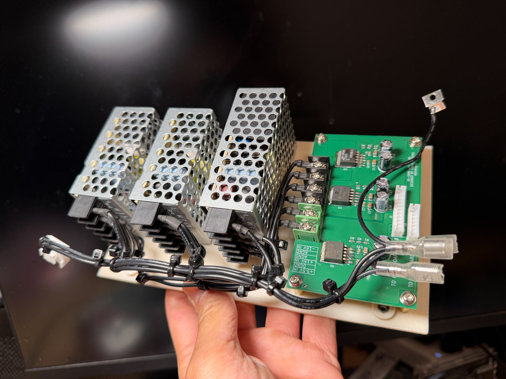
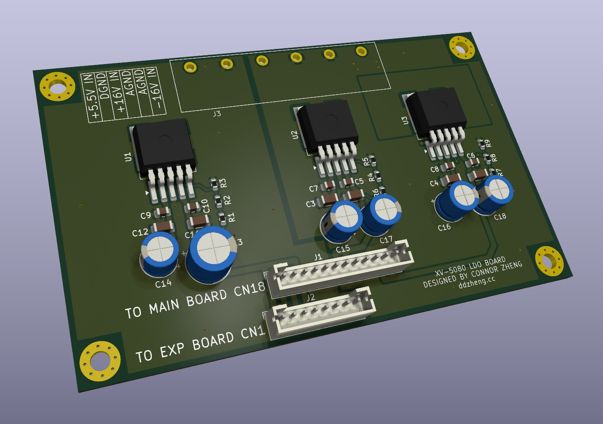
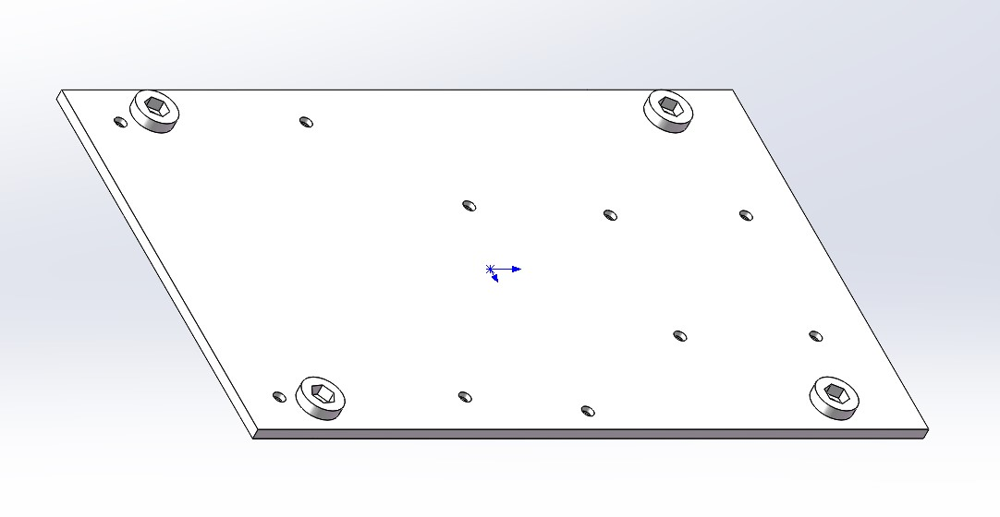
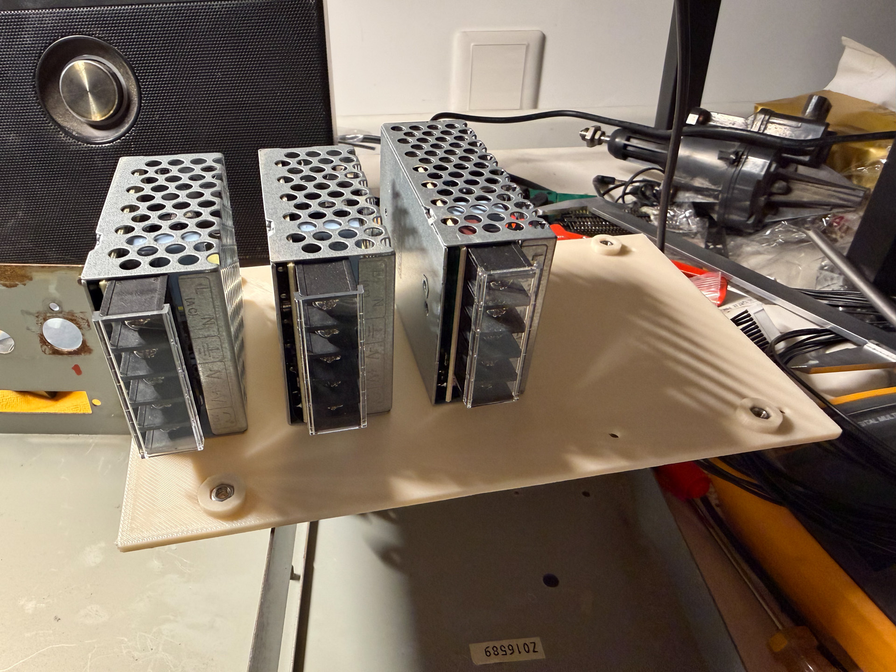
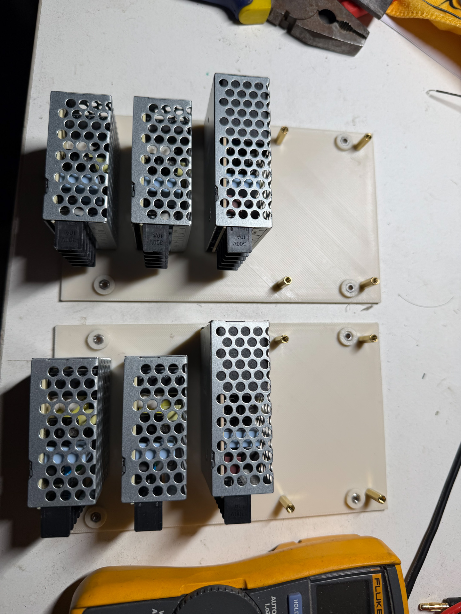
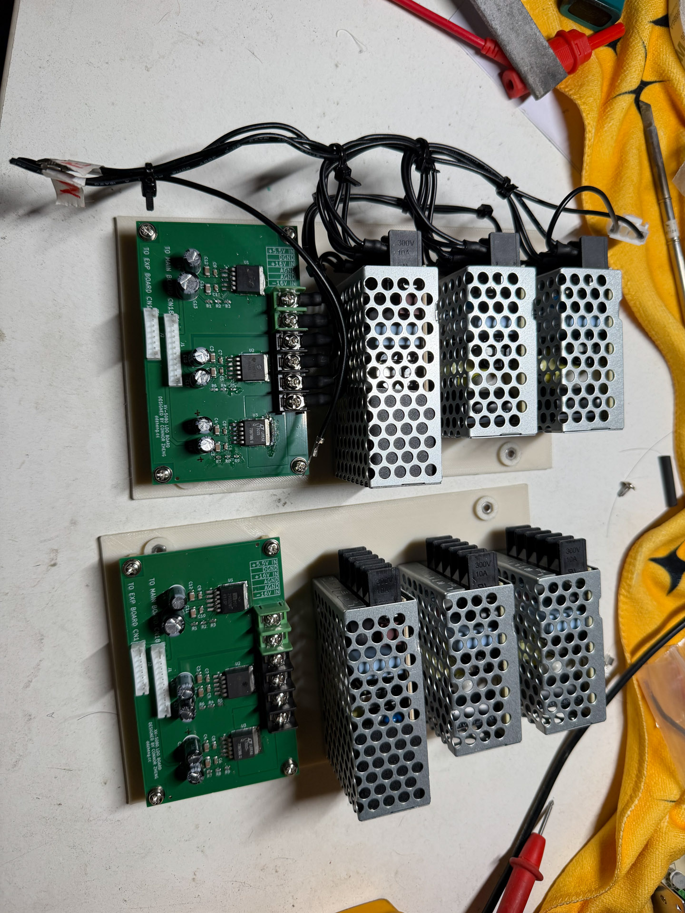
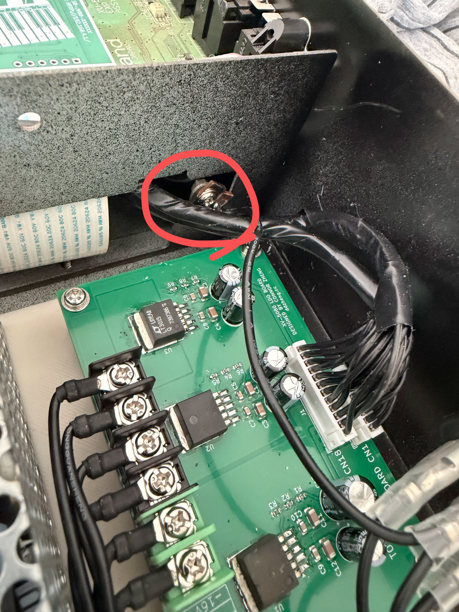
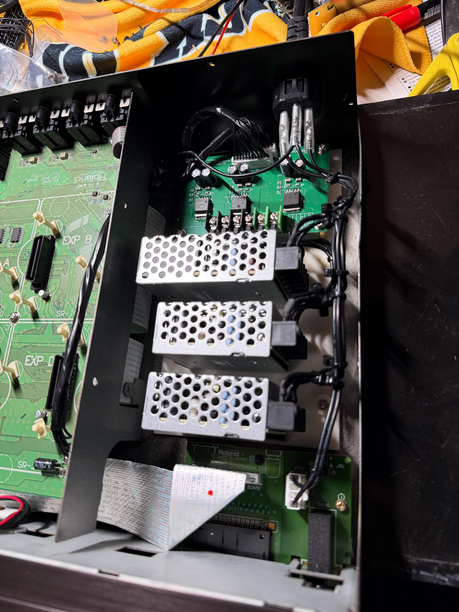

# DIY Power Supply for Roland XV-5080

This is a replacement power supply for the Roland XV-5080. It uses 3 commercial off-the-shelf MEANWELL power supplies and a custom PCB with LDO to condition the power rails.

## LDO Board

The LDO board sits between the 3 SMPS and the rest of the synthesizer to clean the power rails. The board is designed using KiCAD 10. Digital and analog gound are separate to avoid gound loop. Assemble the board as indicated, in case KiCAD is not used, production files are provided. A interactive BOM is provided for manual soldering. 

I used 7.62mm screw type terminal block to connect the DC input but you can also just solder wires directly to the board. 

The 5V LDO is MIC29502, which can be replaced with MIC29302 if it's difficult to source. The +15V LDO is LT1963 which can be replaced with TL1963. The -15V LDO is LT3015.

## PSU Chassis

The 3 SMPS and the LDO board are all mounted on the chassis and is mounted into the XV-5080 as one assembly. The chassis will be mounted using the 4 holes for the factory power supply.

The chassis is 3D-printed. Recommended printing parameters are: no support, 0.2mm or lower layer height, 100% infill, using ABS or ASA. PLA or PETG are not recommended as those can degrade or deform if the synthesizer is subjected to high heat (for example during transportation in a vehicle).

After printing is finished, 4 M3 nuts need to be pressed into the hexagonal receiving slot. These embedded nuts will hold the entire PSU to the XV-5080.

## PSU Assembly

**Please make sure you are qulified to work with mains electrical. Risk of electric shock. Must use grounded AC mains connection.**

### Components

To make a complete set of power supply you'll need the following components:

- 1x mounting chassis (3D printed, STL is provided)
- 2x MEANWELL RS-15-15
- 1x MEANWELL RS-25-5
- 1x LDO board (design file and manufacturing file provided)
- 4x M3 nut (for embedding into chassis)
- 10x M3x8 countersink screw (for mounting SMPS and board to PSU chassis)
- 4x M3x15 standoff/spacers, female-female (for LDO board)
- 8x M3x8 pan head screw (for LDO board mounting and PSU chassis to XV-5080 mounting)
- 18AWG or larger gauge wire rated for >=300V like 1007 or 1569
- 1x 3.2mm ring crimp terminal and crimping tool (for PE)
- 21x 3.2mm fork type crimp terminal and crimping tool (optional)
- VH3.96 connector set and crimping tool (optional, can re-use original wire harness)
- 1x AC connector IEC C14 SCHURTER 6100.4312 (optional, if replacing original AC connector)

The 3 switch mode power supply can be subsituted with other model but you must make sure their outputs are isolated from the PE and chassis.

### Assembly Steps
1. Mount the 3 SMPS to the chassis using 6 M3 countersink screws

2. Mount the LDO board to the chassis using 4 M3 countersink screws, 4 spacers and 4 pan head screws

3. Make the AC side electrical connection using wire (18AWG or larger), optionally with fork type crimp terminals. The power switch is wired inline in L line between the AC input and the SMPSs, the factory connector for the switch is VH3.96. Wire all 3 SMPS AC inputs together.

   - AC INPUT PE ---- XV-5080 chassis and 3 SMPS PE
   - AC INPUT L ---- Switch ---- 3 SMPS L
   - AC INPUT N ---- 3 SMPS N

4. Make DC side electrical connection using wire (18AWG or larger), optionally with fork type crimp terminals. 

   - RS-25-5 +V ---- LDO Board +5.5VIN
   - RS-25-5 -V ---- LDO Board DGND
   - first RS-15-15 +V ---- LDO Board +16VIN
   - first RS-15-15 -V ---- LDO Board AGND
   - second RS-15-15 +V ---- LDO Board AGND
   - second RS-15-15 -V ---- LDO Board -16VIN

5. Remove original power supply standoff. Put assembly into synthesizer, connect or solder switch and AC input. Wire PE connection to the chassis using a ring crimp terminal. Do not mount the PSU to synthesizer or connect output yet. See image for recommended grounding location

6. Connect AC power and turn on power. Using a multimeter to measure the output of the SMPS. Adjust 5V SMPS output to 5.7V, 15V SMPS output to 16.5V. Verify LDO board output voltage using multimeter.
7. Remove AC power and disconnect AC input cable, connect LDO board output to synthesizer using original cable.
8. Mount PSU chassis to XV-5080 using 4 M3x8 pan head screws
9. Apply power again and test functionality.

